<h1 align="center">Contribution Skyline</h1>

<p align="center">
  
</p>

<p align="center">
  The last year of my GitHub contributions as a <b>pixel-art city at night</b>.
  Every day is a plot. The busier the day, the taller the building and the more windows are lit.
</p>

## What it shows

- **Weeks are neighborhoods.** 53 blocks, oldest on the left. Each block has 7 plots one behind another, Sunday at the back and Saturday at the front.
- **Empty days are parks**: grass, trees, sometimes a bench or a street lamp.
- **Height is log-scaled** to the year's busiest day, so one huge day doesn't flatten the rest.
  - **Houses** with pitched roofs for light days.
  - **Apartment blocks** for medium days.
  - **Towers** with a blinking antenna light for the busiest.
- **Lit windows = that day's contributions**, up to the building's capacity.
- **Today** is a construction site with a crane.
- **Always night.** Stars twinkle and a few windows flicker. Animations are pure CSS and respect `prefers-reduced-motion`.

## How it works

```
src/fetch.js       GitHub GraphQL → validated calendar
src/layout.js      days → plots (week, depth, height, kind, lit windows)
src/sprites.js     plot → pixel ops (park, house, apartment, tower, crane)
src/sky.js         night sky, stars, moon, ground
src/font.js        3×5 pixel font for the caption
src/raster.js      pixel ops → one 1px-stroke path per color
src/svg.js         composes the SVG and its CSS animations
scripts/render.mjs CLI → dist/skyline.svg
```

Everything visual is seeded by the date, so a given day looks the same on every run. The SVG has no scripts and no external resources, so it renders in a README ``.

A GitHub Action runs every 6 hours. It renders the SVG and force-pushes it to a single-commit `output` branch.

## Use it for your own profile

1. Fork this repo and enable Actions on the fork (forks start with workflows turned off).
2. Run the **Build the skyline** workflow once.
3. Embed `https://raw.githubusercontent.com/<you>/contribution-skyline/output/skyline.svg` in your profile README.

Private contributions count if **"Private contributions"** is turned on in your GitHub profile settings. The workflow's `GITHUB_TOKEN` then sees them, and no extra token is needed. If you'd rather keep that setting off, create a classic token with the `read:user` scope and save it as the repo secret `SKYLINE_TOKEN`.

## Run it locally

```bash
npm test                                        # unit tests + coverage
npm run render -- --fixture fixtures/real.json  # no token needed
npm run preview                                 # open dist/preview.html
SKYLINE_TOKEN=... npm run render                # live data
```

Requires Node 22+. There are no dependencies.

## License

MIT
