# Contribution Skyline — Design

**Date:** 2026-11-26
**Owner:** arif-aygun
**Status:** Final draft, awaiting user approval

## 1. Intent

Turn the last year of GitHub contributions into a **pixel-art night city**. Every day is one plot. Busy days become taller buildings with lit windows, and empty days become parks and trees. A GitHub Action regenerates the image every day, and the image is embedded in the `arif-aygun` profile README as an SVG.

**Why:** It is decoration for the profile, meant to be the most eye-catching thing on it. The current `github-readme-activity-graph` line chart is the thing it replaces visually.

**Success:** Someone landing on the profile stops and looks at it. The city reads as a skyline at README width. Busy stretches clearly look busier than quiet ones, and the image still looks good, not barren, even though most days are empty.

## 2. The data it has to survive

Measured on 2026-11-26 for `arif-aygun` (authenticated, private included):

| | |
|---|---|
| Days in calendar | 369 (53 weeks, partial first and last week) |
| Total contributions | 834 (404 of them private/restricted) |
| Zero days | 248 (**67%**) |
| Max single day | 83 |
| Typical non-zero day | 1–5 |

Consequences, both decided:
- Empty days must look intentional (parks and trees), not like gaps.
- Height must use a **log scale**. With a linear scale the 83-day building dwarfs everything else.

## 3. Goals / non-goals / anti-goals

**Goals**
- One plot per calendar day for the past year, grouped into 53 week blocks.
- Height reflects the day's contribution count on a log scale. Lit windows show the actual count.
- Always night, with light motion.
- Regenerated automatically every day. Includes private contributions.
- A single self-contained SVG that works in a GitHub README ``.

**Non-goals (for v1)**
- Packaging as a reusable Marketplace Action (approach 2). The renderer is kept pure so this can be added later as a thin `action.yml` wrapper.
- Themes, day/night cycle, real weather, multiple users.
- An interactive web page.

**Anti-goals (failure even if it "works")**
- Looks empty or sparse, like a graph full of holes.
- Looks blurry or smeared when scaled. It must stay crisp pixel art.
- One outlier day flattens the rest of the city.
- The file is so heavy that the README loads slowly. Target **< 250 KB**, ideally < 150 KB.
- It is a copy of an existing project's look. gh-skyline (3D STL) and snk (snake) are prior art in spirit only.

## 4. Constraints

- GitHub renders README images through camo as ``. **No JavaScript and no external fonts or resources.** CSS `@keyframes` inside the SVG does work.
- The default `GITHUB_TOKEN` cannot see private contributions. A PAT with `read:user` scope is required, stored as repo secret `SKYLINE_TOKEN`. Verified: an authenticated `viewer`/`user` query returns the calendar with private contributions already folded in (834 total includes 404 restricted).
- The calendar can contain 365–371 days, with partial first and last weeks.
- The repo `arif-aygun/contribution-skyline` does not exist yet. It must be **public**, because the README embed uses `raw.githubusercontent.com`, as `gtu-window` (public) does. Creating and pushing it is an outward-facing step, so the user confirms it at that point. *(Builder's call recorded by Claude.)*
- **Token setup:** the user creates a **classic PAT with the `read:user` scope** and saves it as the secret `SKYLINE_TOKEN`. The render step logs `totalContributions` and the restricted count, so a run that is missing private contributions is visible in the log. *(Claude's call.)*
- **"Today"** = the last day in the calendar the API returns. No timezone conversion is done. The API may bucket days in UTC, so for a few hours after local midnight the crane can sit on the previous local day. This is accepted. *(Claude's call.)*
- Node 22, ESM, plus the user's global rules: small files (<400 lines), pure functions, no mutation, tests with ≥80% coverage.

## 5. Approaches considered

1. **Standalone Node script and Action in this repo, SVG pushed to an `output` branch.** ← **Chosen.**
   Same pattern as `gtu-window`, which already works for this user. The renderer is a pure `data → SVG string` function: easy to test, previews instantly, and can later be wrapped as a reusable Action.
2. **Reusable Marketplace Action (like Platane/snk).** More reach, but it means input validation, versioning, bundling and docs. Too much for v1. Deferred, and approach 1 keeps the door open.
3. **Reuse the gtu-window canvas → GIF/PNG pipeline.** Rejected. The user asked for SVG, GIFs blur when scaled and are heavy, and per-frame animation is wasteful for a few twinkles.

## 6. Design

### 6.1 Layout (user decision: B, week blocks)

- 53 **week blocks** sit left to right, oldest on the left. Each block is a small neighborhood with **7 plots in depth**: Sunday at the back, Saturday at the front, matching the GitHub calendar row order.
- **Light isometric/oblique projection.** Each depth row is offset up and sideways by a fixed number of pixels, so the back rows peek over the front ones. Everything is drawn back to front (painter's algorithm).
- **Visibility (user decision):** the goal is a real skyline, not a calendar you can read day by day. A busy week must read as a dense, tall neighborhood, and a quiet week as a park area. Individual days in the back rows **may be partly or fully hidden** behind taller front buildings. That's accepted. Keep the depth offset small (skyline feel). The image height must not grow just to expose back rows.
- **Scale:** the viewBox width should let an art pixel render at ≈1 screen pixel or more at ~840 px README width. Don't go much below 1×, or crispEdges starts dropping pixel columns. The builder checks this in the preview at 840 px.
- Partial first and last weeks: missing days are simply empty ground (not parks), so the edges don't look like extra empty days.
- Thin streets between week blocks. A subtle month marker on the ground is optional (builder's call).
- **Pixel grid:** everything is drawn in integer pixel units with `shape-rendering="crispEdges"`. The `viewBox` is in pixel units and the SVG scales to README width (`width="100%"`). The overall size is the builder's call, with readability at ~840 px display width as the target.

### 6.2 Plots (user decision: empty days are parks and trees)

| Day | Plot |
|---|---|
| 0 contributions | Park: grass, 1–2 trees, sometimes a bench or street lamp (varied, deterministic per date) |
| Low | Small house with a pitched roof |
| Mid | Apartment block |
| High | Tower with a flat roof, antenna and blinking red light |
| Today | Construction site: the building at its current height plus a crane (a park with a crane if today is 0) |

- **Height:** `floors = 1 + round(k · log2(count))`, with `k` chosen so the year's max day hits the max height. The scale is normalized per render.
- **Type thresholds** (house/apartment/tower): builder's call. Base them on floors or on quantiles of non-zero days so a typical year gets a mix of all three.
- **Windows:** each building has a window grid. The number of lit windows equals the day's count, capped at the window capacity, in which case the building is fully lit. Which windows are lit is chosen by a **PRNG seeded by the date**, so a given day looks the same every render.
- Small per-plot variations (building color tint, roof style, tree type) are also seeded by date.

### 6.3 Night scene (user decision: always night, light motion)

- Dark navy gradient sky (or banded pixel gradient), pixel stars, a moon. Moon phase is optional and could reuse `gtu-window/docs/js/moon.js`.
- **Animations, CSS `@keyframes` only:**
  - Stars twinkle (opacity), with staggered `animation-delay`.
  - A small set (~10–20) of lit windows flicker or toggle on and off, picked deterministically.
  - Tower antenna lights blink.
  - Optional: the crane light on today's plot blinks.
- Wrap all animation in `@media (prefers-reduced-motion: no-preference)`.
- A caption in pixel font, e.g. `834 contributions in the last year`, drawn as rects (adapt the 3×5 font from `gtu-window/docs/js/font.js`, adding the glyphs needed). Placement is the builder's call (sky or ground).

### 6.4 File size strategy

Hundreds of buildings with window grids means thousands of rects. To stay under budget:
- Merge same-colored pixels into **one `<path>` per color** (run-length rows → `M x y h w v 1 h -w z`), instead of one `<rect>` per pixel.
- Only animated elements get their own element or class.
- A test asserts the size budget on a heavy fixture (all days at max).

### 6.5 Architecture

```
src/fetch.js        GraphQL → validated calendar [{date, count}], throws on bad shape
src/layout.js       calendar → plots with (week, weekday, x, y, kind, floors, litCount, seed)  [pure]
src/sprites.js      plot → pixel ops (house/apartment/tower/park/crane)                         [pure]
src/sky.js          stars, moon, gradient                                                        [pure]
src/font.js         pixel font (adapted from gtu-window)
src/raster.js       pixel ops → merged per-color paths                                           [pure]
src/svg.js          composes the final SVG string with the <style> animations                   [pure]
src/prng.js         seeded PRNG (e.g. mulberry32 over a hash of the date)
scripts/render.mjs  CLI: fetch (or --fixture file) → dist/skyline.svg
scripts/preview.mjs writes dist/preview.html showing the SVG at 1×/2× and README width
test/*.test.mjs     node --test
fixtures/*.json     real snapshot + synthetic (all-zero, all-max, partial weeks, single spike)
```

### 6.6 Data fetch

- Query `user(login: $login) { contributionsCollection { contributionCalendar { totalContributions weeks { contributionDays { date contributionCount weekday } } } } }`.
- Login comes from the env var `SKYLINE_USER` (default `arif-aygun`). The token comes from `SKYLINE_TOKEN`, falling back to `GITHUB_TOKEN` with a warning that private contributions will be missing.
- Validate the response shape (array of weeks, non-negative integer counts, ISO dates). On any failure, exit non-zero. The `output` branch then keeps the previous SVG untouched.

### 6.7 Automation

`.github/workflows/skyline.yml`, modeled on `gtu-window/.github/workflows/window.yml`:
- Triggers: `schedule` every 6 hours (so today's construction site grows through the day), `push` to `main`, `workflow_dispatch`.
- Steps: checkout → setup-node 22 → `npm ci` → `npm test` → `npm run render` → force-push `dist/skyline.svg` to a single-commit `output` branch.
- `concurrency` group to avoid overlapping runs. `permissions: contents: write`.

### 6.8 Embedding

Profile README (`arif-aygun/arif-aygun`):
```html
<p align="center">
  
</p>
```
Whether it replaces the existing activity graph is to be confirmed with the user before editing the profile repo. That repo is outside this project and changing it is outward-facing.

## 7. Testing

- **Unit:** the log height scale (max day → max floors, 1 → 1 floor, monotonic); park on zero; type thresholds; lit count = min(count, capacity); PRNG determinism; path merging produces the same pixel set as the input ops.
- **Properties:** same input → byte-identical SVG; output is well-formed XML; no `<script>`, no external `href`; size < budget on the all-max fixture; partial weeks handled.
- **Fetch:** shape validation rejects malformed responses (mock `fetch`, no network in tests).
- **Visual check:** `npm run preview` with the real fixture before shipping, then check the actual README render on GitHub.

## 8. Left to the builder

Exact pixel dimensions and projection offset, palette, type thresholds, tree and park variants, caption placement, moon phase yes/no, month markers yes/no. All of this stays within the constraints above (crisp, night, not empty, < 250 KB).
